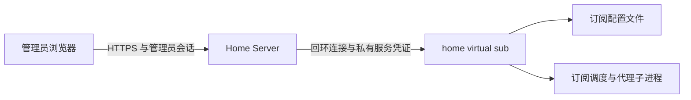

# home virtual sub 管理

## 目标与边界

管理员通过管理中心查看、新增、编辑、删除订阅，并查看运行状态及刷新、启停单个订阅。home virtual sub 独立运行，订阅配置和代理进程由其自身管理；Home Server 负责管理员鉴权、界面和操作记录。

管理连接为可选启动配置，默认关闭。首版用于同机部署，管理服务监听回环地址。保留已有账号、业务模块、代理监听地址和订阅启动行为。



## 管理接口

浏览器接口前缀为 `/api/admin/home-virtual-sub`，服务接口前缀为 `/management/v1`。接口只允许固定路径和动作，订阅名称通过 `name` 查询参数传递，支持原有非 ASCII 名称。

| 方法与相对路径 | 行为 |
| --- | --- |
| `GET /status` | 返回服务启动时间、核心类型、检查间隔、配置版本、运行数量及订阅状态 |
| `GET /subscriptions` | 返回脱敏配置列表；不包含订阅 URL 或代理密码 |
| `GET /subscriptions/detail?name=…` | 返回管理员编辑需要的订阅 URL 和普通字段；代理链只标记存在 |
| `POST /subscriptions` | 新增订阅并触发生效 |
| `PATCH /subscriptions?name=…` | 编辑原订阅；名称保持不变 |
| `DELETE /subscriptions?name=…` | 停止并删除订阅 |
| `POST /subscriptions/refresh?name=…` | 请求刷新订阅 |
| `POST /subscriptions/start?name=…` | 启用并启动订阅 |
| `POST /subscriptions/stop?name=…` | 停止订阅，定时刷新不会重新启动 |

服务成功响应为直接 JSON；浏览器响应沿用 Home Server 的 `code`、`message`、`data` 结构。状态响应包含 `api_version: 1`、`started_at`、`core_type`、`interval_second`、`revision`、`total`、`running`、`stopped`、`workers`。每个 worker 包含 `name`、`bind_ip`、`http_port`、`socket_port`、`url_count`、`enabled`、`running`、`state`、`last_error`、`last_refresh_at`、`last_success_at`。

配置列表为 `{revision, subscriptions}`；浏览器可见字段为 `name`、`bind_ip`、`http_port`、`socket_port`、`outbound_server_count`、`url_count`、`has_proxy_chain`，详情额外返回 `urls`。服务接口中的生成文件名不会转发给浏览器。新增与编辑仅接受名称、URL、监听地址、两个端口和出站节点数量（1–5）；修改保留生成文件名、代理链和其他未展示字段。两种监听端口必须不同，且在 1–65535 之间；服务检查与其他订阅及实际监听端口的冲突。

写请求携带 `If-Match` 中的配置摘要版本。Home Server 额外要求 `current_password` 和 `reason`，这些字段不转发给服务。服务写结果为 `{saved, revision, apply_state, message}`，`apply_state` 为 `pending`、`applied` 或 `error`。服务错误为 `{error: {code, message}}`，错误码限定为 `invalid`、`conflict`、`not_found`、`unauthorized`、`unavailable`，不得返回原始订阅响应、运行配置或带凭证的错误。

## 持久化与进程生命周期

订阅配置只有服务端一个写入者，不复制到 Home Server 数据库。保存按完整配置摘要检测并发修改，以同目录临时文件和原子替换持久化，保留未修改字段。管理模式允许零订阅。

配置保存与生效分别报告；刷新及启动由服务生命周期管理，HTTP 请求结束不能终止代理进程。操作有界，状态查询不等待外部订阅拉取。编辑只调整目标订阅；改变端口等配置会使对应代理短暂中断。

运行中复用当前端口并扩大监听范围（例如 `127.0.0.1` 改为 `0.0.0.0` 或 `::1` 改为 `::`）时，先停止订阅，再修改并启动。扩大范围需要检查新增地址上的端口占用；保留旧核心时无法完成该检查，因此服务拒绝直接在线扩大范围，不保存该次编辑。

删除先停止调度并确认子进程退出，再持久化删除和移除 worker。保存失败恢复原启用状态并报告实际结果。成功删除后，定时刷新及重启均不能复活订阅。临时停止不持久化，服务重启仍按原有启动规则启用已配置订阅。

## 权限、界面与异常

复用管理员会话、HTTPS、Origin、CSRF 和当前密码校验，应用凭证与普通用户不能管理订阅。连接地址和服务凭证只存在受限启动配置中，响应采用 `Cache-Control: no-store`。管理操作沿用审计结构，摘要仅记录名称、端口、动作和结果。

写操作先持久化 `in_progress` 审计意图，再调用服务；不在数据库事务中等待网络。返回的保存和生效结果独立于审计更新结果，浏览器结果包含 `audit_recorded`。服务超时或返回不可用时记录 `unknown`，需重新读取配置及状态核对；进程中断后仍为 `in_progress` 的记录也按结果未知处理。审计更新失败不会把已经完成的服务操作描述为回滚。

界面位于管理中心，使用状态摘要、订阅列表、编辑表单和操作确认。每 5 秒读取状态，隐藏页面暂停刷新；请求失败清除在线状态并显示当前状态未知。服务可连接、代理运行和最近订阅刷新结果分别展示。写入超时提示结果待核对，不自动重发。

## 验收

| 场景 | 通过条件 |
| --- | --- |
| 权限 | 未登录、普通用户、应用身份、错误密码或 CSRF 均不能触发服务写入 |
| 配置 | 新增重启保留；编辑保留未展示字段；版本冲突与保存失败不覆盖配置 |
| 进程 | 请求结束后子进程继续运行；目标订阅变更不停止其他订阅 |
| 删除 | 删除最后一个订阅后管理服务仍可用；重启不会恢复已删除订阅 |
| 异常 | 服务断连不显示旧在线状态；保存和生效分别报告；错误和审计没有凭证 |
| 兼容 | 默认关闭时旧配置、登录、页面和业务 API 保持原行为 |

验证在 `ssh pi` 的独立临时目录、合成配置与空闲端口进行，不使用运行配置或停止现有服务。

## 部署连接

Home Server 需要已完成数据库账号迁移，使用管理员浏览器会话及同源 HTTPS。连接只接受字面量回环 IP，不接受用户信息、查询参数或附加路径；不经过环境代理，不跟随重定向。

```yaml
home_virtual_sub:
  enabled: true
  base_url: http://127.0.0.1:18190
  token_file: /etc/home_server/home_virtual_sub.token
  timeout_ms: 5000
```

管理服务的凭证与此文件内容一致。凭证为 32–256 个可见 ASCII 字符，文件须为运行用户可读取的普通文件，且组与其他用户没有权限，建议使用 `0600`；两个服务使用不同系统账号时，各持有内容一致的私有文件。凭证不进入 Git、浏览器、审计摘要或日志。连接配置属于启动参数，修改后重启 Home Server；管理员在页面上维护订阅，无需日常 SSH。

已有 `/api/admin/` Nginx 规则覆盖全部新增接口，不增加公开管理服务端口。升级先部署支持 v1 契约的管理服务，再部署 Home Server 并启用连接；旧配置缺少 `home_virtual_sub` 时仍关闭。关闭集成可设 `enabled: false` 后重启 Home Server，已有订阅代理继续按服务自身配置运行。新接口无需数据库 DDL。
